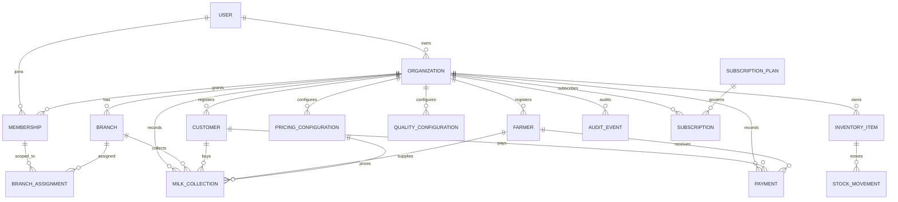

# DairyNexus architecture

## Architecture style

DairyNexus is a modular monolith built with Django. Each domain is a Django application, but all modules run in one deployment and use one relational database. This avoids premature service boundaries while keeping business logic separated into models, forms, views, selectors, permissions and transactional services.

## Runtime components

- Django handles server-rendered web pages, authentication, sessions, CSRF protection and the ORM.
- PostgreSQL is the intended production database. SQLite is the default local-development database.
- Redis is configured as the production cache backend and is the intended foundation for background work.
- WhiteNoise serves versioned static assets in a simple container deployment.
- Gunicorn is the production WSGI server.
- Docker Compose provides a local infrastructure recipe.

## Django application boundaries

| App | Responsibility |
|---|---|
| `accounts` | UUID-based custom user, authentication, registration, password reset/change |
| `organizations` | Dairy tenants, branches, membership, role and branch assignments |
| `parties` | Customer and Farmer records and customer self-service portal |
| `pricing` | Effective-dated price configurations, quality profiles and calculation/validation services |
| `collections` | Milk collection workflow, pricing snapshot, approvals |
| `finance` | Payment recording/verification and approval-based expense records |
| `inventory` | Supplier directory, inventory items and transactional stock ledger |
| `platform_admin` | Subscription plans, subscriptions and superuser overview |
| `audit` | Actor, tenant, event and target audit trail |
| `core` | Shared UUID/time-stamped bases, health endpoint and demo seeding |

## Multi-tenancy and access resolution

The first version uses a shared PostgreSQL schema. Each tenant-owned business model contains an `organization_id` foreign key. An organisation slug in the URL is only a lookup key; it never grants access.

The `organization_access` decorator resolves the current user’s active membership server-side, confirms the tenant is active/trial, optionally restricts roles, and sets `request.organization` and `request.membership`. Web views filter all tenant records by the resolved organisation. Users cannot override tenant identity using a posted organisation ID.

Roles currently modelled: owner, organisation admin, branch manager, collection operator, quality officer, accountant, inventory manager and support. Owners/admins have organisation-wide branch scope. All other membership roles are restricted to their explicit branch assignments; an empty assignment list gives access to no branch.

Platform administration is separate: the current platform overview requires a Django superuser. A platform superuser does not gain an organisation membership by default.

Customer portal access resolves a Customer record by `user=request.user`, not by an ID supplied by the browser.

## Milk collection lifecycle

1. The authenticated actor enters a branch, party, collection timestamp, quantity and quality measurements.
2. Form querysets are tenant-filtered. The service independently checks that the branch and party belong to the resolved organisation and are active.
3. The service finds the approved price version effective on the collection date. A branch-specific version takes precedence over the tenant-wide version.
4. An effective quality profile is selected if configured. Ranges are not hard-coded; a configured profile is validated, while absence of a profile is explicitly recorded.
5. The pricing formula is executed on the server using `Decimal`.
6. The calculated rate, total, pricing version and configuration snapshot are saved with the collection inside a database transaction.
7. The collection is initially `submitted`; authorised owner/admin/quality-officer users can approve it through a POST action.
8. Audit events are recorded for creation and approval.

Historical collection snapshots are not recomputed when current prices or quality profiles change.

## Finance

Payments have direction, method, amount, currency and pending/completed/failed/reversed state. Customer payments must be incoming and farmer payments outgoing. Newly recorded payments remain pending. An authorised owner/accountant performs the explicit completion action. Expenses have a tenant, branch, category, amount, date, recorder and approval state; owner/accountant approval is required. Updates use row locking and audit events. The finance app now also contains a tenant-scoped chart of accounts, accounting periods, journal entries and journal lines, with transactional balanced posting, idempotency keys, branch authorization, and reversal journals. Posted entries/lines reject normal model-level edits and deletes. Existing transactions are not backfilled and payment/expense/collection lifecycle posting adapters are not yet enabled. Invoice allocation, bank reconciliation, period close, supplier payables, FX and database-enforced append-only controls remain later scope. See [accounting ledger foundation](accounting-ledger.md) for posting rules and limitations.

## Inventory and suppliers

Suppliers and items are tenant-scoped. Items belong to a branch and can refer to an organisation supplier. Stock changes are posted as ledger movements (purchase/return/transfer in increase stock; usage/transfer out decrease stock). The service locks the item row and prevents negative balances. This is an operational stock ledger, not yet a full purchasing/warehouse system with purchase orders, goods-received notes, transfers between branches and supplier settlement.

## Data integrity

- UUID primary keys for user and business entities.
- Decimal fields for money, quality and measured quantity.
- Unique tenant-scoped business codes and references.
- Database check constraints for positive quantities/amounts and valid measurement/configuration ranges.
- `PROTECT` on historical relationships where deletion would invalidate a financial or collection record.
- `transaction.atomic` for business creation, collection and payment operations.
- `select_for_update` for inventory and payment status changes.

## Text ERD

## Important current boundaries

- The current portal covers customer history and payments only; a farmer self-service portal is not yet implemented.
- The platform overview and subscription records exist; automated subscription charging, billing-provider webhooks and plan-limit enforcement remain to be implemented.
- Inventory has models and a transactional movement service, but its full screens, supplier purchasing and low-stock notifications remain pending.
- No external payment provider is connected. An online payment stays pending until a trusted verification workflow is implemented.
- No legacy data migration is performed because the original SQL dump is absent.
- Database migrations must be generated, reviewed and committed before production rollout.
